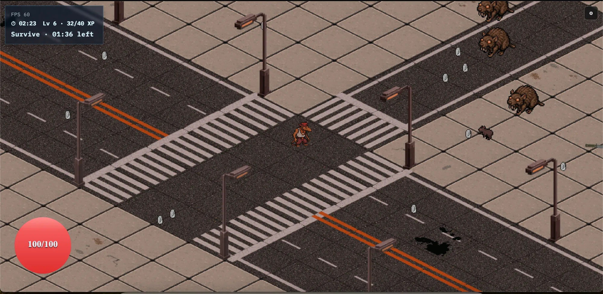

# Rat Game

**Play it in the browser: [lillerupjr.github.io/RatGame](https://lillerupjr.github.io/RatGame/)**



An isometric survivors-style action game set in a noir rat underworld. Pick a rat, climb an act map, survive two-minute floors against escalating swarms, build around rings, and take down the act boss.

Built from scratch in TypeScript with a custom engine: no game framework, just Vite, Canvas2D/WebGL and a handful of small libraries.

## Gameplay

1. **Pick a rat.** Five characters, each with their own starting weapon (syringe, pistol, throwing knife, laser, shotgun). Weapons fire automatically; you focus on movement.
2. **Climb the act map.** Eight rows of branching nodes: combat floors, a shop, a rest stop and the act boss at the top.
3. **Survive.** Each combat floor is a 120-second survival timer while a spawn director ramps up the pressure.
4. **Build with rings.** Clearing a floor offers a choice of rings. Rings sit on eight finger slots across two hands and stack stat modifiers, on-hit/on-kill triggers, damage-over-time effects and rules such as living bombs, poison trails or neighbor amplification.
5. **Beat the boss.** The final row is a boss arena. Win or die, the run ends on a stats screen where you can submit to the online leaderboard.

### Controls

| Action | Input |
|---|---|
| Move | WASD or arrow keys |
| Rings / hands screen | H |
| Pause | Esc |
| Mobile | On-screen controls |

## Technical highlights

- **Custom isometric renderer** with two backends, Canvas2D and WebGL, behind one render-command pipeline. Frames are built as sorted slice commands with viewport culling, then submitted to whichever backend is active.
- **Texture atlases.** A static atlas for structures and decals and a dynamic atlas for entities, projectiles and VFX, packed at runtime with bleed borders.
- **Lighting and shadows.** Heightmap-based structure shadows, a sun/day cycle and per-entity shadow offsets.
- **Palette system.** All runtime art is normalized to the DB32 palette and remapped live for saturation and darkness variants.
- **Map pipeline.** Maps are authored as JSON (fields, stamps, chunk grids), stitched and compiled into tile topology, height, road markings, occlusion and triggers.
- **ECS-lite simulation.** Systems own their world fields and communicate only through shared state and events: movement, collisions, combat, ailments, AI, spawning.
- **Data-driven progression.** 65 rings defined as typed effect data (stat mods, triggered effects, combat rules), validated at load and resolved through one stat pipeline.
- **Online leaderboard** backed by Supabase.
- **PixiJS hands screen** for equipping rings, with live stat previews.

## Engineering practice

- **Tests:** about 930 Vitest tests across 167 files, covering map compilation, rendering order, combat rules, progression and rewards. CI runs typecheck, tests and a production build on every push.
- **Canonical docs:** each system has a canonical doc in [`docs/canonical/`](docs/canonical/) describing purpose, pipeline, invariants and failure modes. Code that disagrees with its doc is treated as drift. Architecture rules live in [`docs/AGENTS.md`](docs/AGENTS.md).
- **Ownership headers:** source files start with an `@agent` header stating which system the file belongs to, what it owns and where related logic lives.
- **AI-assisted workflow:** the docs and headers double as context for coding agents, so changes stay scoped to one system and keep its docs current.

## Project structure

```
src/
  engine/      rendering backends, sprites, palette, audio, world container
  game/        simulation systems, content, maps, progression, bosses
  ui/          DOM menus, overlays, PixiJS hands screen
  settings/    persisted user, debug and system settings
  tests/       Vitest suites
public/        runtime art and audio
docs/          canonical system docs, contracts, design notes
supabase/      leaderboard backend
```

What is currently playable is listed in [`docs/design/active_content.md`](docs/design/active_content.md).

## Development

```bash
npm install
npm run dev
```

```bash
npm run typecheck
npm run test
npm run build
```

The live site deploys from the `live` branch through GitHub Actions.
